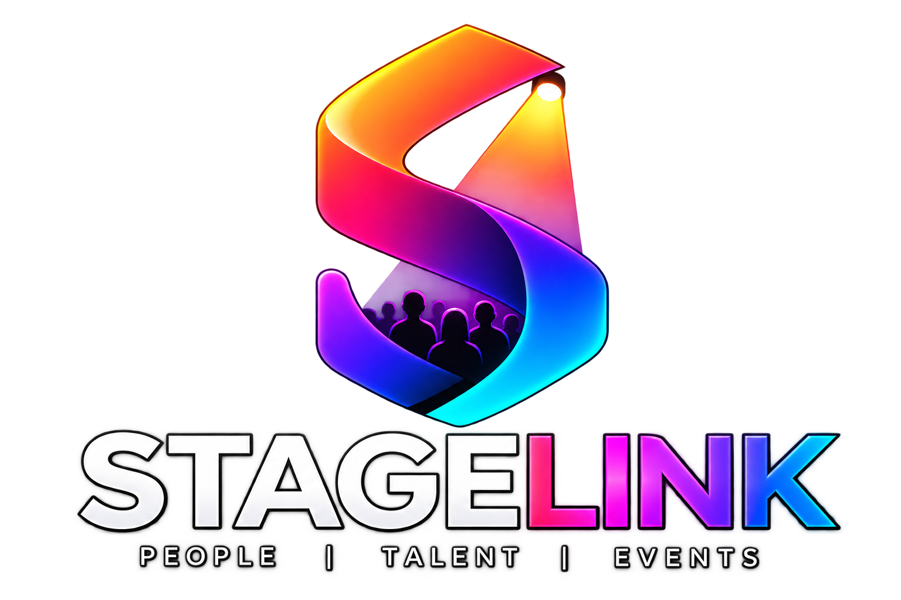
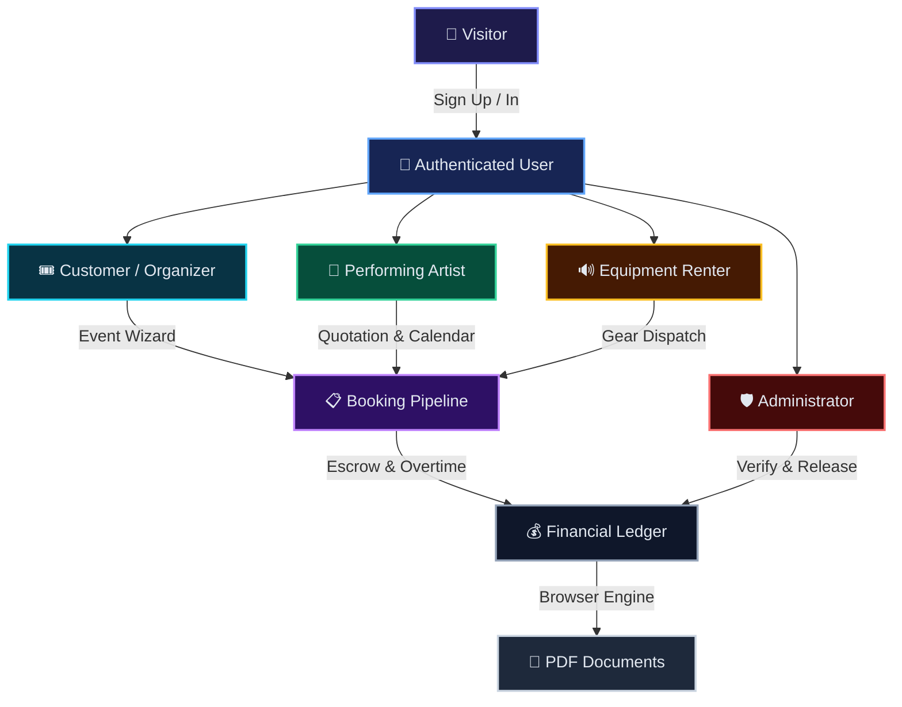

<div align="center">


<br/>



<br/><br/>

<a href="https://git.io/typing-svg">
  
</a>

<br/><br/>

<p>
  <a href="https://stagelink-kohl.vercel.app/"></a>&nbsp;
  <a href="https://github.com/fusion5-labs/StageLink-Frontend/actions"></a>&nbsp;
  &nbsp;
  
</p>

<p>
  <a href="https://react.dev"></a>&nbsp;
  <a href="https://vitejs.dev"></a>&nbsp;
  <a href="https://www.typescriptlang.org"></a>&nbsp;
  <a href="https://tailwindcss.com"></a>
</p>

<p>
  <a href="https://www.framer.com/motion"></a>&nbsp;
  <a href="https://threejs.org"></a>&nbsp;
  <a href="https://pnpm.io"></a>&nbsp;
  
</p>

<br/>

> ### 🌟 *Explore live talent • Rent production gear • Negotiate in real time • Secure escrow payments • Generate client PDFs*

<br/>


</div>

<br/>


<br/>

## 📖 Executive Summary

**StageLink** is a comprehensive, multi-role web platform designed to streamline the **entire lifecycle of live entertainment and event production**. By consolidating artist discovery, gear rental logistics, real-time contract negotiations, milestone escrow payments, and administrative compliance into a single cohesive experience, StageLink eliminates fragmentation in the live event industry.

Powered by **React 19**, **Vite 8**, **Tailwind CSS v4**, **Framer Motion**, and **Three.js WebGL**, StageLink offers dynamic animations, rich liquid-glass aesthetics, interactive 3D elements, and instantaneous role switching across **five discrete user personas**.

---

## 🌟 Core Pillars

<table>
<tr>
<td align="center" width="25%">

### 🎭 Talent & Gear
Multi-category artist catalog & rental logistics

</td>
<td align="center" width="25%">

### 💬 Negotiation
Interactive chat, itemized quotes, counteroffers

</td>
<td align="center" width="25%">

### 💳 Escrow Engine
10% advance hold, 5% single fee, overtime escrow

</td>
<td align="center" width="25%">

### 📑 PDF Generation
Client invoice, payment receipt & provider statement

</td>
</tr>
</table>

## ⚡ Key Innovations

<details>
<summary><b>🌌 1. 3D Interactive WebGL Audio Visualizer</b> &nbsp;— click to expand</summary>
<br/>

- **Interactive Three.js Canvas**: Custom 3D music note visualizer with GLTF models (`public/models/music-note-collection.glb`) rendered via `@react-three/fiber` and `@react-three/drei`.
- **Dynamic Post-Processing**: Bloom effects, custom depth of field, and mouse-reactive lighting that responds to user movement.
- **Liquid Glass Distortion Shaders**: Real-time glassmorphism shader (`liquid-glass.js`) delivering chromatic aberration and fluid refraction effects.

</details>

<details>
<summary><b>💳 2. 3D Flipping Credit Card & Escrow Checkout</b> &nbsp;— click to expand</summary>
<br/>

- **Interactive Card Physics**: Smooth 180-degree 3D Y-axis card flip animation triggered when the user focuses the CVV security field.
- **Milestone Escrow Rules**: Financial transactions calculated in exact integer cents. Supports an optional 10% advance held in escrow, with a single 5% platform fee deducted once across transfers.
- **Overtime & Settlement Logic**: Integrated overtime requests, approval locks, dispute holds, and simulated one-click card/wallet payments.

</details>

<details>
<summary><b>📄 3. Browser-Native PDF Generation Engine</b> &nbsp;— click to expand</summary>
<br/>

- **Zero-Backend Document Generator**: Built directly in the browser using `jspdf` with embedded Noto Sans vector typography.
- **Professional Financial Documents**:
  - `StageLink-INV-*.pdf` — Official itemized customer booking invoices.
  - `StageLink-RCT-*.pdf` — Timestamped payment receipts for advance and final balances.
  - `StageLink-SETTLE-*.pdf` — Complete provider payout statements with fee deductions.

</details>

<details>
<summary><b>💬 4. Real-Time Negotiation & Quotation Pipeline</b> &nbsp;— click to expand</summary>
<br/>

- **In-Chat Offer Formulation**: Providers submit itemized quotes with customizable line items, quantities, and milestone terms.
- **Counteroffer Workflows**: Customers can submit structured counteroffers; superseded versions are cleanly archived with complete version history.
- **Interactive Simulator**: Built-in typing indicators, simulated incoming partner responses, unread counters, and seen state management.

</details>

---

## 🎭 The 5-Persona Omnichannel Architecture

> StageLink provides instantaneous role switching via the bottom-right **Demo Role Switcher** or top navigation bar



| Role | Primary User Journey | Core Features & Dashboards |
| :--- | :--- | :--- |
| **👤 Visitor** | Explore platform, preview talent, check pricing | Video hero, Morphing Discovery bar, Top talent carousel, Sliding Auth Modal |
| **🎟️ Customer** | Plan events, hire performers, rent gear | Multi-step booking wizard, Wishlist store, Quotation negotiations, 3D checkout |
| **🎸 Artist** | Manage gigs, schedule bookings, receive payouts | Availability calendar, Quotation generator, Live gig timer, Overtime tracker |
| **🔊 Equipment Renter** | Manage rental gear fleet, handle reservations | Daily capacity tracker, Fleet inventory, Delivery dispatch, Rental quotes |
| **🛡️ Administrator** | Platform governance, escrow safety, audit | KYC review queue, Escrow fund release, Dispute mediation, System controls |

---

## ✨ Animations, Transitions & Motion Design

> Powered by **Framer Motion** (`framer-motion` & `motion` v13.4)

<table>
<tr><td>

**🪟 Sliding Dual-Panel Auth Modal** — `AuthModal.tsx`
Spring transition (`stiffness: 300, damping: 30`) with simultaneous horizontal translateX on form panels and a sliding gradient overlay. Zero-reload transition between **Sign In** and **Sign Up** while preserving user input state.

</td></tr>
<tr><td>

**🔮 Morphing Category Discovery Bar** — `morphing-discovery-bar.tsx`
Shared layout animations using Framer Motion's `layoutId`. Active category indicators glide seamlessly beneath selections with magnetic cursor-following feedback.

</td></tr>
<tr><td>

**🎠 Embla Motion Carousel** — `MotionCarousel.tsx`
Continuous inertia physics with touch, drag, and mouse-wheel support. Cards scale smoothly on center-focus with depth perspective and subtle neon glow drops.

</td></tr>
<tr><td>

**💳 Interactive 3D Card Flip** — `PaymentGlass.tsx`
CSS 3D perspective (`perspective: 1000px`) and `transform: rotateY(180deg)` with smooth ease-in-out cubic bezier curves. Card seamlessly flips between cardholder front and CVV signature strip on back.

</td></tr>
<tr><td>

**🌊 Staggered Panel Entrance Animations** — `usePanelEntrance.ts`
Coordinated cascade delays (`staggerChildren: 0.08s`) with subtle vertical translation (`y: 16px → 0px`) and opacity fades. Dashboards feel organic and reactive upon mounting.

</td></tr>
<tr><td>

**🌙 Dynamic Theme Morphing** — `SwitchMode.tsx`
Color interpolation across CSS custom properties (`--sl-bg`, `--sl-panel`, `--sl-accent`). Morphs between **Concert Neon Stage Mode** (purples, cyan glow) and **Deep Cosmic Dark Mode** (obsidian slate, high-contrast typography).

</td></tr>
</table>


## Fusion-5

<div align="center">

<table>
  <tr>
    <td align="center" width="20%" valign="top">
      <a href="https://github.com/Ravindu200324511398">
        
        <br/>
        <sub><b>Ravindu Saranga</b></sub>
      </a>
      <br/>
      
      <br/>
      <small>3D WebGL Canvas, Auth Modal & Visitor Landing</small>
    </td>
    <td align="center" width="20%" valign="top">
      <a href="https://github.com/Nezz77">
        
        <br/>
        <sub><b>Nesandu Hesitha</b></sub>
      </a>
      <br/>
      
      <br/>
      <small>Booking Chat, Quotation Engine & Testing</small>
    </td>
    <td align="center" width="20%" valign="top">
      <a href="https://github.com/Manuri2003">
        
        <br/>
        <sub><b>Manuri Pabara</b></sub>
      </a>
      <br/>
      
      <br/>
      <small>Talent Directory, Portfolio & Availability</small>
    </td>
    <td align="center" width="20%" valign="top">
      <a href="https://github.com/dinuka03">
        
        <br/>
        <sub><b>Dinuka</b></sub>
      </a>
      <br/>
      
      <br/>
      <small>Event Planning Wizard, Gear Fleet & Wishlist</small>
    </td>
    <td align="center" width="20%" valign="top">
      <a href="https://github.com/djshamintha">
        
        <br/>
        <sub><b>Jhone Shamintha</b></sub>
      </a>
      <br/>
      
      <br/>
      <small>Escrow Ledger, PDF Documents & Admin Desk</small>
    </td>
  </tr>
</table>

</div>

<br/>

### 🏗️ Architectural Domain Ownership

| Member | Module | Core Files & Components |
| :--- | :--- | :--- |
|  Ravindu Saranga | Core Platform & Visitor Experience | `App.tsx`, `main.tsx`, `index.css`, `LandingPage.tsx`, `AuthModal.tsx`, `SplashScreen.tsx`, `SwitchMode.tsx`, `MusicNoteScene.tsx`, `liquid-glass.js`, `Icons.tsx` |
|  Nesandu Hesitha | Negotiation & Real-Time Pipeline | `BookingChat.tsx`, `MessagesCenter.tsx`, `NotificationCenter.tsx`, `booking-chat.css`, `pipeline.css`, `pipeline.test.mjs`, `MODULE4-EVALUATION.md` |
|  Manuri Pabara | Artist & Performer Ecosystem | `ArtistDashboard.tsx`, `ArtistCollectionCard.tsx`, `BrowseArtistsPage.tsx`, `collections.css`, `community.ts`, `community.test.mjs` |
|  Dinuka | Customer & Equipment Marketplace | `CustomerDashboard.tsx`, `RentEquipmentPage.tsx`, `RenterDashboard.tsx`, `SavedItems.tsx`, `SaveListingButton.tsx`, `PricingShowcase.tsx`, `dashboard.css` |
|  Jhone Shamintha | Finance, PDF Documents & Admin Desk | `PaymentCheckout.tsx`, `PaymentGlass.tsx`, `BookingMilestones.tsx`, `BookingSettlement.tsx`, `BookingDocuments.tsx`, `documentPdf.ts`, `AdminDashboard.tsx`, `tests/` |

---

## 📂 Project Architecture

<details>
<summary><b>📁 Click to expand full directory tree</b></summary>
<br/>

```
StageLink-Frontend/
├── 📁 public/                           # Static assets, 3D models & vector fonts
│   ├── 🎬 Stage-Link-Background.mp4     # Ambient concert hero video loop
│   ├── 🖼️  stagelink-logo.png            # Transparent brand identity
│   ├── 🔮 liquid-glass.js               # WebGL liquid refraction shader
│   ├── 📁 models/                       # 3D GLTF assets
│   │   ├── music-note.glb
│   │   └── music-note-collection.glb
│   └── 📁 fonts/                        # Embedded vector typography for PDF engine
│       ├── NotoSans-Regular.ttf
│       └── NotoSans-Bold.ttf
├── 📁 src/
│   ├── 📁 components/                   # UI components & interactive panels
│   │   ├── AdminDashboard.tsx           # Platform oversight & compliance desk
│   │   ├── ArtistCollectionCard.tsx     # Interactive performer card
│   │   ├── ArtistDashboard.tsx          # Performer booking & schedule manager
│   │   ├── AuthModal.tsx                # Dual-panel animated sliding auth modal
│   │   ├── BookingDocuments.tsx         # In-browser PDF invoice & receipt viewer
│   │   ├── BookingMilestones.tsx        # Milestone progress tracker
│   │   ├── BookingSettlement.tsx        # Escrow payout calculations
│   │   ├── CustomerDashboard.tsx        # Organizer event planning wizard
│   │   ├── LandingPage.tsx              # Flagship video hero & showcase
│   │   ├── MotionCarousel.tsx           # Embla-powered touch carousel
│   │   ├── PaymentCheckout.tsx          # 3D animated credit card checkout
│   │   ├── PaymentGlass.tsx             # Card flip presentation component
│   │   ├── RentEquipmentPage.tsx        # Audio, lighting & stage gear catalog
│   │   ├── RenterDashboard.tsx          # Fleet availability & dispatch tracker
│   │   ├── SavedItems.tsx               # Wishlist store & favorite items
│   │   ├── SplashScreen.tsx             # Animated brand intro screen
│   │   └── SwitchMode.tsx               # Stage Concert / Cosmic theme switcher
│   ├── 📁 lib/                          # State management, pipeline & PDF engines
│   │   ├── booking.ts                   # Escrow rules & integer-cent financial ledger
│   │   ├── BookingContext.tsx           # React context for active negotiations
│   │   ├── bookingDocuments.ts          # PDF document schemas & data formatting
│   │   ├── DashboardContext.tsx         # Multi-role dashboard global state
│   │   ├── documentPdf.ts               # jsPDF vector document builder
│   │   └── pipeline.ts                  # Quotation & counteroffer state machine
│   ├── App.tsx                          # Root orchestrator & role switcher
│   ├── main.tsx                         # Vite React 19 entry point
│   └── index.css                        # Tailwind CSS v4 design tokens & themes
├── 📁 tests/                            # Automated test suites (69 tests)
│   ├── booking.test.mjs                 # Escrow calculations & fee deductions
│   ├── community.test.mjs               # Profiles, reviews & verification tests
│   ├── completion.test.mjs              # Event lifecycle & gig completion
│   ├── dashboard.test.mjs               # Multi-role state & draft persistence
│   ├── module4.test.mjs                 # Quotations, overtime & refund desk
│   └── pipeline.test.mjs                # Chat negotiation state machine
├── 🐳 Dockerfile                        # Multi-stage production container build
├── 🐳 docker-compose.yml                # Container orchestration
├── ⚙️  nginx.conf                        # Production Nginx reverse proxy config
├── 📦 package.json                      # Dependencies & build scripts
├── 🔒 pnpm-lock.yaml                    # Deterministic pnpm dependency lockfile
└── ⚡ vite.config.ts                    # Vite 8 & Tailwind CSS v4 compiler config
```

</details>

---

## 💰 Financial & Escrow Rule Specifications

> The financial engine guarantees mathematical precision and prevents double-fee deductions

<table>
<tr>
<td>

**1️⃣ Integer-Cent Calculations**

All currency operations use integer cents (`$2,000.00` = `200000`) to completely eliminate IEEE 754 floating-point rounding errors.

</td>
<td>

**2️⃣ 10% Optional Advance**

Organizers can secure an artist by paying a 10% advance deposit held in escrow before the event.

</td>
</tr>
<tr>
<td>

**3️⃣ Single 5% Platform Fee**

StageLink charges a flat 5% fee on the agreed base amount, **deducted once** from the first disbursement across multiple installments.

</td>
<td>

**4️⃣ Overtime Protocol**

Overtime hours must be requested by the provider, approved by the organizer, and paid into escrow. **Overtime does not increase the initial platform fee**.

</td>
</tr>
<tr>
<td colspan="2">

**5️⃣ Administrative Safeguards**

Funds can only be released upon mutual completion or explicit administrative sign-off, protecting both parties against fraud and cancellations.

</td>
</tr>
</table>

---

## 🚀 Getting Started

### ✅ Prerequisites

| Requirement | Version |
| :--- | :--- |
| **Node.js** | `v20.0.0+` *(v22 LTS or v26 recommended)* |
| **pnpm** | `v9.x` or `v12.x` *(or npm)* |

### ⚙️ Installation & Local Setup

```bash
# 1. Clone the repository
git clone https://github.com/Nezz77/StageLink-Frontend.git
cd StageLink-Frontend

# 2. Install dependencies with pnpm
pnpm install

# 3. Start development server
pnpm dev
```

> 👉 App launches at **`http://localhost:8443/`** *(or `http://localhost:5173`)*

---

## 🛠️ Command Reference

| Command | Action | Description |
| :---: | :--- | :--- |
| `pnpm dev` | ⚡ **Start Dev Server** | Launches Vite dev server with instant HMR on port 8443 |
| `pnpm build` | 📦 **Production Build** | Compiles optimized bundle in `dist/` in ~380ms |
| `pnpm preview` | 👁️ **Preview Build** | Serves compiled production build locally |
| `pnpm test` | 🧪 **Run Test Suite** | Runs all 69 automated unit & integration tests |
| `pnpm typecheck` | 🔍 **Type Checking** | Runs `tsc --noEmit` across all TypeScript modules |
| `pnpm format` | ✨ **Code Formatting** | Formats code with ultra-fast `oxfmt` |

---

## 🧪 Test Suite — 69 / 69 Passing

<details>
<summary><b>🟢 Click to view full test results</b></summary>
<br/>

```bash
pnpm test
```

```text
✔  price includes no customer surcharge; fractional cents round consistently
✔  quote agreement, amount, version, payment kind and customer role are required
✔  optional advance is held until admin transfer and is releasable before the gig
✔  advance then final payment deducts the 5% fee once across both admin transfers
✔  overtime requires another party approval and changes final balance, never the original fee
✔  only admin can resolve a pending refund, with a reason and explicit boolean decision
✔  invoice, receipt and provider settlement derive from current ledger with no customer fee
...
ℹ  tests       69
ℹ  suites       0
ℹ  pass        69
ℹ  fail         0
ℹ  cancelled    0
ℹ  skipped      0
ℹ  duration_ms  184ms
```

</details>

---

## 🐳 Docker Deployment

```bash
# Build and run containerized app
docker-compose up --build -d

# Check running containers
docker ps
```

> 🌐 Production container served on **`http://localhost:80`**

---

## 📚 Academic Context

<div align="center">

| | |
| :--- | :--- |
| 🏗️ **Institution** | Faculty of Information Technology · University of Moratuwa |
| 📘 **Course** | IN2901 · Software Development Project (2026) |
| 🎓 **Degree** | BSc (Hons) in Information Technology |
| 👥 **Group** | **FUSION 5** *Group No: 6* |
| 🏢 **Industry Partner** | **99x** |
| 👨‍🏫 **Supervisor** | Mr. P K K N S Jayathilake |

</div>

<br/>

### 📎 Project Documentation

<div align="center">

| Document | Description |
| :---: | :--- |
| 👥 [**Individual Contributions Dossier**](docs/INDIVIDUAL_CONTRIBUTIONS.md) | Complete breakdown of responsibilities and achievements for all 5 team members |
| 📋 [**Project Specification & Scope**](docs/PROJECT_SPECIFICATION.md) | Problem statement, aim, objectives, inclusions/exclusions, and technology mapping |
| 📐 [**System Design & Diagram Index**](docs/SYSTEM_DESIGN_AND_DIAGRAMS.md) | Use case, ER/EER models, class diagram, activity flows, and module sequence diagrams |
| 📖 [**Consolidated Academic References**](REFERENCES.md) | Complete bibliography and research literature review |

</div>

---

### 👥 Student Contributors & Module Distribution

| Index No. | Student Name | Role | Module Scope |
| :---: | :--- | :---: | :--- |
| **244107G** | R S D P Kodikara | 👑 Lead, Module 1 | **Visitor & Customer Management**: Public preview feed, authentication, faceted search & discovery, event wizard, AI recommendations, verified review & rating system |
| **244148G** | K J T M Pabara | 🎨 Lead, Module 2 | **Artist & Talent Management**: Specialized onboarding, multimedia portfolio, tiered gig packages, AI listing generation, calendar availability synchronization |
| **244049E** | P D P Disanayaka | 🛠️ Lead, Module 3 | **Renter & Equipment Marketplace**: Renter storefront, equipment & venue listing wizard, AI specification generator, inventory tracking, dispatch & payout logic |
| **244076H** | M W N Hesitha | ⚡ Lead, Module 4 | **Booking Pipeline, Real-Time Chat & Payments**: Socket.IO negotiation, itemized quotations, counteroffers, booking state machine, PayHere/Stripe integration |
| **244077L** | D J S Hettiarachchi | 💼 Lead, Module 5 | **Admin Panel & Central AI Engine**: Executive KPI analytics, identity verification queue, dispute resolution, Python FastAPI matchmaking microservice, LLM content generation API |

---

### 📖 Literature Review & References

1. **[1]** Fernando, K. and Perera, S. (2022), *"Applications of ontological modeling and digital transformation in entertainment logistics"*, *Sri Lanka Journal of Information Technology*, 14(2), pp. 45–62.
2. **[2]** Jayawardena, A. (2023), *"Transactional Friction and Escrow Mechanisms in Multilateral Service Marketplaces"*, *Journal of Software Engineering and Applications*, 8(1), pp. 112–130.
3. **[3]** Live101 (2026), *"Live Artist Booking Platform"*, Live101, India. [https://www.live101.in/](https://www.live101.in/) *(Accessed: 18 September 2026)*.
4. **[4]** Silva, M. (2024), *"Real-Time Communication Protocols and State Machine Modeling for Service Platforms"*, *International Journal of Computer Systems*, 19(3), pp. 88–104.
5. **[5]** Wickramasinghe, N. and De Silva, R. (2025), *"Applied Natural Language Processing and LLMs for Automated E-Commerce Listing Generation"*, *Asian Journal of Computer Science*, 11(4), pp. 201–218.

---

## 📄 License & Attribution

<div align="center">

Designed and developed by **Team Fusion-5** for the Second Year Software Engineering Project at the
**University of Moratuwa** (2026) in collaboration with **99x**
All brand assets, 3D models, and demo interfaces are licensed for academic and showcase purposes.

<br/>


</div>
